<h1 align="center">Consul Service Discovery on AWS for Bagisto</h1>

<p align="center">
  
</p>

A highly available e-commerce platform on AWS. Nginx finds healthy shop servers through Consul, not fixed IPs. Every tier lives in an Auto Scaling group across three Availability Zones, and every tier rebuilds itself when its instances are lost. GitHub Actions tests, scans, and ships each change to the shop as an immutable image, and Ansible rolls it out over Session Manager. No instance has a public IP or an SSH key.

The storefront is [Bagisto](https://github.com/bagisto/bagisto), an open-source Laravel e-commerce application (MIT). This repository is the platform around it: network, infrastructure as code, service discovery, delivery pipeline, and operations.

> This repository presents the project. The source code is private and available on request.

**Key results**

- **Self-healing on every tier.** Consul, Nginx, and Bagisto each recovered automatically after all of their instances were terminated at once. Losing every Consul server caused no downtime.
- **Gated delivery.** Seven quality and security gates, an image scan, and a smoke test run before any image reaches ECR.
- **About ten minutes from merge to production**, with rollback to any earlier image by its git SHA.
- **No fixed IPs.** Every server is found through Consul and AWS tags, so any instance can be replaced without a code change.
- **Zero standing access.** No public IPs on instances, no SSH keys, and no stored AWS keys: Session Manager for access, OIDC for the pipeline.

[](https://aws.amazon.com/)
[](https://www.terraform.io/)
[](https://github.com/features/actions)
[](https://www.consul.io/)
[](https://www.ansible.com/)
[](https://aws.amazon.com/ecr/)
[](https://nginx.org/)
[](https://bagisto.com/)

| | |
| --- | --- |
| **Region** | `us-east-1` |
| **Network** | VPC `10.20.0.0/16` · three Availability Zones · public, private app, and private data subnets · one NAT Gateway per AZ |
| **Edge** | ALB with ACM (TLS 1.2/1.3 policy) · HTTP `:80` redirects to HTTPS · Route 53 alias `bagisto.simsoliver.com` |
| **Discovery** | Consul cluster (three servers, one ASG per AZ) · cloud auto-join by tag · consul-template drives Nginx |
| **Runtime** | Nginx ASG (3–6) · Bagisto ASG (3–6) running the shop container · queue worker · single scheduler via Consul lock |
| **Data** | RDS MySQL 8.0 Multi-AZ · ElastiCache Redis 7.1 (TLS, auth, failover) · Elasticsearch 8 (TLS) · EFS for media |
| **Delivery** | GitHub Actions · seven quality and security gates · Trivy · immutable ECR tags · Ansible over SSM · rollback by SHA |
| **Secrets** | Secrets Manager JSON · IAM instance profiles · GitHub OIDC role · no access keys, no SSH keys |
| **IaC** | Terraform modules with S3 remote state · Ansible for the shop · boot scripts for Consul and Nginx |
| **Resilience** | Each tier tested by terminating all of its instances at once · every tier recovered with no manual action |

---

## Contents

1. [Overview](#overview)
2. [Architecture](#architecture)
3. [Design choices](#design-choices)
4. [Source layout (private repository)](#source-layout-private-repository)
5. [CI/CD](#cicd)
6. [Configuration](#configuration)
7. [Hosts and self-healing](#hosts-and-self-healing)
8. [Data services](#data-services)
9. [Email](#email)
10. [Application (working run)](#application-working-run)
11. [Security snapshot](#security-snapshot)
12. [Challenges and solutions](#challenges-and-solutions)
13. [Next steps](#next-steps)
14. [Cost](#cost)
15. [Operations](#operations)

---

## Overview

Bagisto is a Laravel shop with a storefront, an admin panel, a queue worker, and a scheduler. Running it on one server is easy. Running it on many servers that come and go is the real problem: the proxy must always know which shop servers are alive, every server must share the same database, cache, search index, and media, and nothing may depend on a hand-written IP address.

This project solves that with Consul. Each shop server registers itself with a health check. Each Nginx server watches Consul and rewrites its upstream list when a shop appears, fails, or is replaced. The Consul servers, the proxies, and the shops all run in Auto Scaling groups and set themselves up at boot.

### Objectives

| Goal | How it is met |
| --- | --- |
| Service discovery without fixed IPs | Consul registration and health checks · cloud auto-join by the tag `Role=consul` · consul-template for Nginx |
| Self-healing on every tier | Consul, Nginx, and Bagisto each in Auto Scaling groups · boot scripts need no Ansible run · tested by terminating whole tiers |
| Gated, repeatable delivery | Lint, static analysis, tests, dependency audit, secret scan, SAST, image scan, and smoke test before any push |
| Least privilege | Private subnets only · security groups paired by role · scoped IAM roles · OIDC instead of keys · Session Manager instead of SSH |
| Stateless shop servers | MySQL, Redis, Elasticsearch, and EFS hold all state · a replaced server loses nothing |
| Operable from scratch | Ordered recreate and destroy runbooks · a new environment is detected and installed once |

---

## Architecture

<table>
  <tr>
    <td align="center">
      <p align="center"><b>Platform architecture</b></p>
      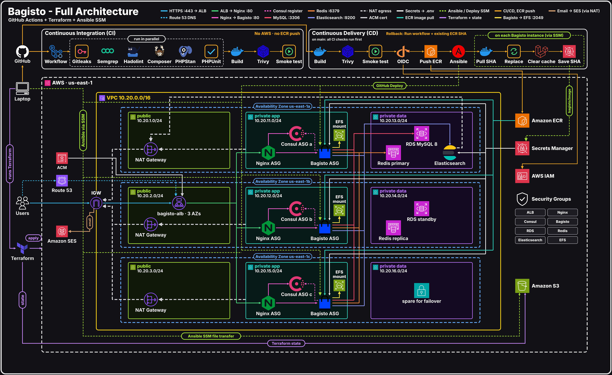
      <br><sub><b>Figure 1.</b> Region us-east-1 · VPC 10.20.0.0/16 · three Availability Zones · CI on pull requests, CD on main.</sub>
    </td>
  </tr>
</table>

| Tier | What runs | Network |
| --- | --- | --- |
| Edge | Application Load Balancer (ACM certificate) | Public subnets in all three AZs · `:443` from the internet · `:80` redirects to `:443` |
| Proxy | Nginx ASG (`t3.micro`, 3–6) with a Consul agent and consul-template | Private app subnets · `:80` from the ALB only |
| Registry | Consul servers (`t3.micro`), one ASG per AZ, one server each | Private app subnets · Consul ports from Consul, Nginx, and Bagisto only |
| App | Bagisto ASG (`t3.micro`, 3–6) running the shop container, queue worker, and scheduler | Private app subnets · `:80` from Nginx only |
| Data | RDS MySQL 8.0 Multi-AZ · Redis primary and replica · Elasticsearch (`t3.small`) · EFS | Private data subnets · each port from the Bagisto security group only |

Private subnets reach the internet through a NAT Gateway in each public subnet, for package installs, image pulls, and AWS APIs. Nothing reaches the instances from the internet except through the ALB.

### Request path

```
Customer  →  Route 53 (bagisto.simsoliver.com)
          →  ALB :443        (TLS terminates here)
          →  Nginx :80       (upstream list written by consul-template)
          →  Bagisto :80     (healthy shop servers only)
          →  MySQL :3306 · Redis :6379 · Elasticsearch :9200 · EFS :2049
```

### Discovery path

```
Bagisto server  →  local Consul agent  →  registers "bagisto" + HTTP health check every 5 s
Consul servers  →  hold the catalog of healthy "bagisto" instances
Nginx server    →  consul-template watches 127.0.0.1:8500  →  rewrites the upstream  →  reloads Nginx
```

Every agent finds the servers by asking AWS for running instances tagged `Role=consul`. A booting Consul server also joins the agents tagged `Role=nginx` and `Role=bagisto`, so the cluster reconnects even after all three servers are replaced at once.

### Application services

Bagisto is one Laravel codebase. The boxes are its runtime roles inside the container and the services they call.

<table>
  <tr>
    <td align="center">
      <p align="center"><b>Service graph</b></p>
      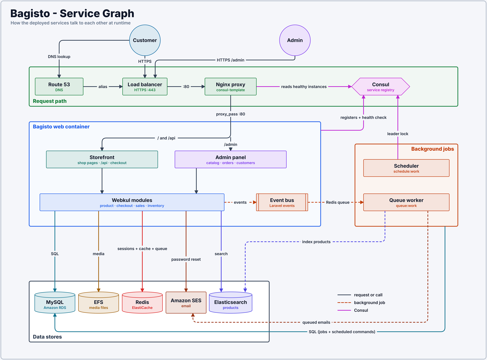
      <br><sub><b>Figure 2.</b> Customer and admin → Nginx → Bagisto · background jobs through Redis · Consul for registration and the scheduler lock.</sub>
    </td>
  </tr>
</table>

---

## Design choices

**Discovery by tag, not by IP.** No IP address is written anywhere: not in Terraform, not in Ansible, not on any instance. Agents use Consul cloud auto-join with `provider=aws tag_key=Role tag_value=consul`. Replacing a server changes nothing in the code.

**One Auto Scaling group per Consul server.** Three ASGs of exactly one server, one per AZ. Each ASG is a watchdog that replaces its server in the same zone, so a replacement can never land next to another server and losing one zone never takes two servers.

**Boot scripts for Consul and Nginx, Ansible for the shop.** Consul servers and Nginx proxies configure themselves from user data, so a replacement serves without any operator. Bagisto shops also boot by themselves from the image recorded in `bagisto/image`. Ansible handles the first install and routine deploys.

**`bagisto/image` means "a deploy finished".** Only Ansible writes it, as the last step after the new container runs. A new Auto Scaling shop boots that exact SHA. An empty value means a new environment: shops wait and the GitHub deploy skips until the first install has run.

**Install once, on shared storage.** The one-time Bagisto install drops and rebuilds the database, so it must never run twice. Its marker lives on EFS where every shop sees it, and the deploy refuses to run unless EFS is mounted.

**State outside the servers.** Sessions, cache, and queue in Redis; catalog and orders in MySQL; search in Elasticsearch; product images on EFS. Any shop server can be terminated at any time.

**One scheduler in a fleet.** Every shop runs a queue worker. The scheduler runs through `consul lock`, so exactly one shop holds it and another takes over when that shop dies.

**Immutable images.** ECR tags are immutable git SHAs, scanned on push, with untagged images expiring after seven days. Rollback redeploys an existing SHA without rebuilding.

---

## Source layout (private repository)

```
.
├── .github/workflows/
│   └── bagisto-ecr.yml          # CI gates → build, scan, smoke, push → deploy over SSM
├── ansible/
│   ├── site.yaml                # first install and full configuration of the shops
│   ├── playbooks/               # bagisto.yaml (full) · bagisto-image.yaml (CI deploy)
│   ├── roles/bagisto/           # secrets, EFS, image, search, Consul agent, scheduler
│   ├── roles/load-balancer/     # consul-template file for Nginx
│   └── inventories/             # aws_ec2 inventory by tag Role=bagisto
├── bagisto/                     # application source, Dockerfile, Nginx and PHP-FPM config
├── docs/
│   ├── architecture/            # platform and service diagrams
│   ├── evidence/                # screenshots from the working run
│   └── *.txt                    # runbooks and walkthroughs
└── terraform/
    ├── bootstrap/               # S3 bucket for remote state (local state for this stack)
    ├── live/                    # the environment: module wiring, tfvars, generated Ansible files
    ├── modules/                 # vpc, sg, iam, secrets-manager, rds, redis, elasticsearch,
    │                            # efs, ecr, acm, alb, ses, compute
    └── scripts/                 # boot scripts for Consul, Nginx, Bagisto, Elasticsearch
```

| Module | Creates |
| --- | --- |
| `vpc` | VPC, nine subnets across three AZs, IGW, one NAT Gateway per AZ |
| `sg` | One security group per role, linked by security-group references |
| `iam` | Instance roles for ops (Consul, Nginx), Bagisto, and Elasticsearch · GitHub OIDC role for ECR push and deploy |
| `secrets-manager` | `bagisto/mysql`, `redis`, `elasticsearch`, `app-key`, `image` |
| `rds` | MySQL 8.0 Multi-AZ, encrypted, TLS required |
| `redis` | Redis 7.1 replication group, encryption at rest and in transit, automatic failover |
| `elasticsearch` | Elasticsearch 8 on EC2 with HTTPS and a generated certificate |
| `efs` | Encrypted shared media drive with a mount target in every app subnet |
| `ecr` | `bagisto` repository, immutable tags, scan on push, lifecycle policy |
| `acm` · `alb` | Certificate for the domain · ALB, target group, Route 53 alias |
| `ses` | Domain identity with DKIM records · optional sandbox test recipients |
| `compute` | Consul ASGs (one per AZ), Nginx ASG, Bagisto ASG, and their launch templates |

### Terraform state

<table>
  <tr>
    <td align="center">
      <p align="center"><b>Terraform state</b></p>
      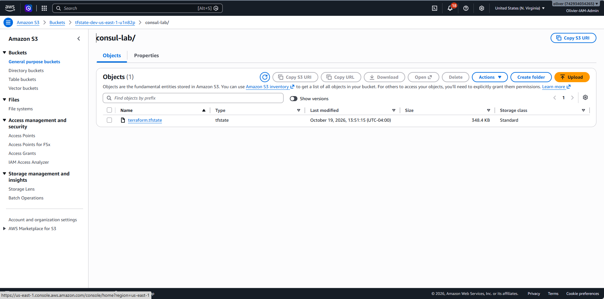
      <br><sub><b>Figure 3.</b> Remote state in an encrypted, versioned S3 bucket · created by <code>terraform/bootstrap</code>.</sub>
    </td>
  </tr>
</table>

---

## CI/CD

<p align="center">
  
</p>

One workflow, `.github/workflows/bagisto-ecr.yml`, runs only when something under `bagisto/` changes, or by hand. Infrastructure and documentation changes do not rebuild the shop.

| Stage | Runs on | What it does |
| --- | --- | --- |
| Gates (parallel) | Pull request and main | Hadolint · PHPStan · unit tests · integration tests · Composer audit · Gitleaks · Semgrep |
| Build | Pull request and main | `docker build` · Trivy (HIGH and CRITICAL with a fix) · smoke test on `:80` · on main only: push `bagisto:<git-sha>` to ECR |
| Deploy | Main only | Assume the OIDC role · find shops by tag · run `bagisto-image.yaml` with Ansible over Session Manager |

### Pull request

A pull request stops before AWS. It proves the change builds and passes every gate.

<table>
  <tr>
    <td align="center" width="50%">
      <p align="center"><b>Pull request</b></p>
      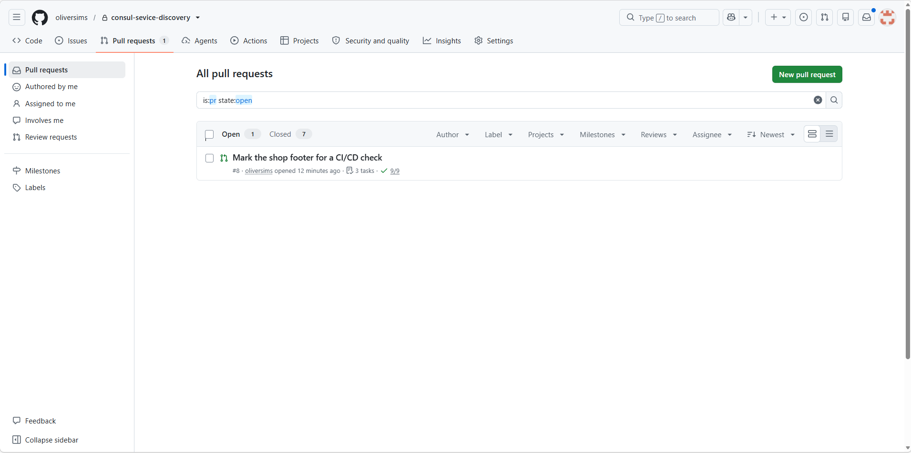
      <br><sub><b>Figure 4.</b> Change proposed as a pull request · 9 of 9 checks.</sub>
    </td>
    <td align="center" width="50%">
      <p align="center"><b>Checks passed</b></p>
      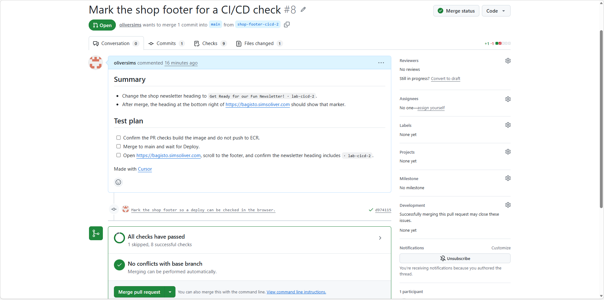
      <br><sub><b>Figure 5.</b> All checks passed · ready to merge.</sub>
    </td>
  </tr>
</table>

### Pull request run

The same pull request in GitHub Actions: the gates run, then Build. Deploy is skipped.

<table>
  <tr>
    <td align="center" width="50%">
      <p align="center"><b>Pull request run · queued</b></p>
      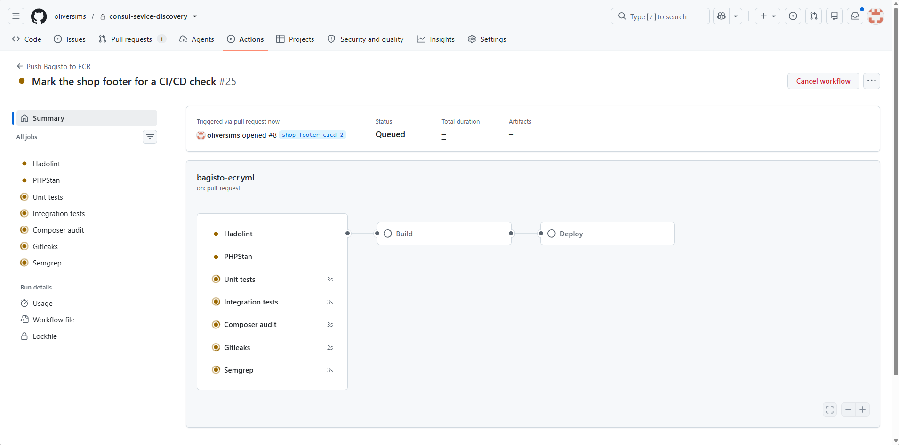
      <br><sub><b>Figure 6.</b> Seven gates start in parallel · Build waits for all of them.</sub>
    </td>
    <td align="center" width="50%">
      <p align="center"><b>Pull request run · success</b></p>
      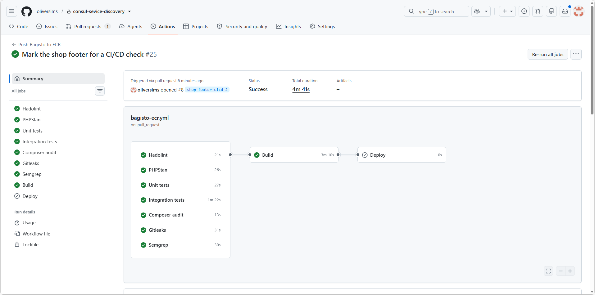
      <br><sub><b>Figure 7.</b> Gates and Build green · Deploy skipped on a pull request.</sub>
    </td>
  </tr>
</table>

### Merge to main

Merging to main runs the same gates, pushes the image, and deploys it.

<table>
  <tr>
    <td align="center" colspan="2">
      <p align="center"><b>Merged</b></p>
      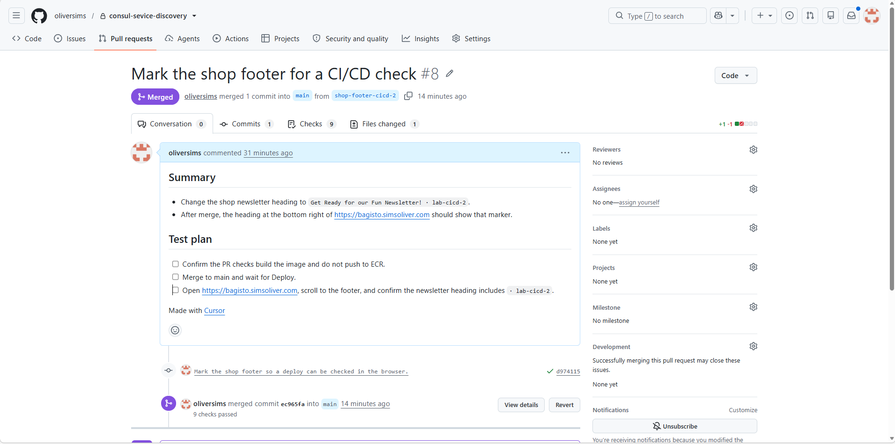
      <br><sub><b>Figure 8.</b> Pull request merged · 9 checks passed on the merge commit.</sub>
    </td>
  </tr>
  <tr>
    <td align="center" width="50%">
      <p align="center"><b>Main run · queued</b></p>
      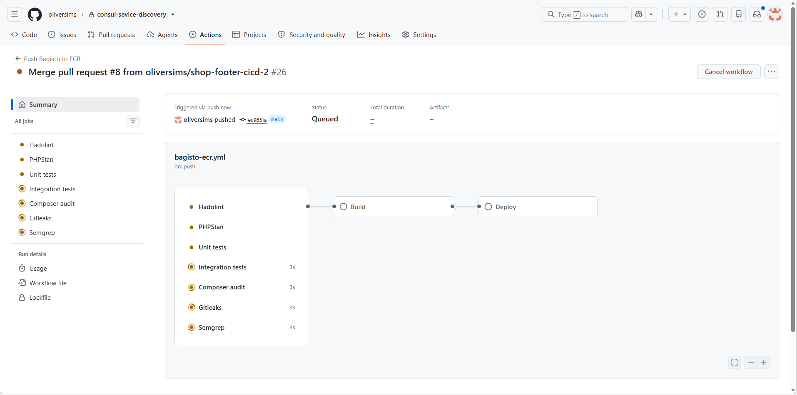
      <br><sub><b>Figure 9.</b> Merge to <code>main</code> triggers the full pipeline.</sub>
    </td>
    <td align="center" width="50%">
      <p align="center"><b>Main run · deployed</b></p>
      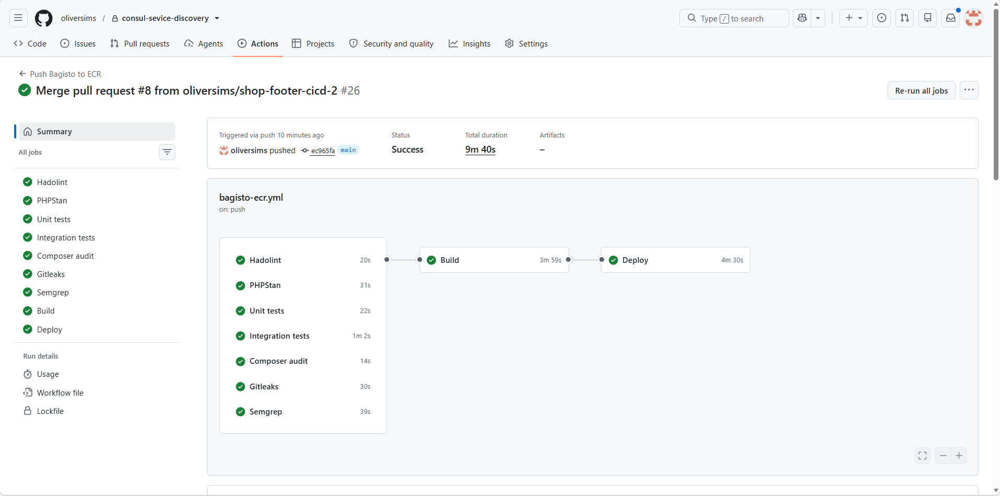
      <br><sub><b>Figure 10.</b> Gates, Build, and Deploy green · about ten minutes end to end.</sub>
    </td>
  </tr>
</table>

### Deploy

`ansible/playbooks/bagisto-image.yaml`, on every shop at once:

1. Read the secrets and render `.env`
2. Skip a new environment (`bagisto/image` has no value yet)
3. Refuse to continue unless EFS is mounted
4. Pull the new SHA from ECR, then replace the `bagisto`, queue, and scheduler containers
5. Relink `public/storage` to EFS · skip the install (marker on EFS)
6. Clear the Laravel and full-page caches
7. Record the SHA in `bagisto/image` for new Auto Scaling instances

**Rollback:** run the workflow by hand with the first characters of an older SHA. It redeploys that image from ECR without rebuilding.

### Image registry

<table>
  <tr>
    <td align="center">
      <p align="center"><b>Amazon ECR</b></p>
      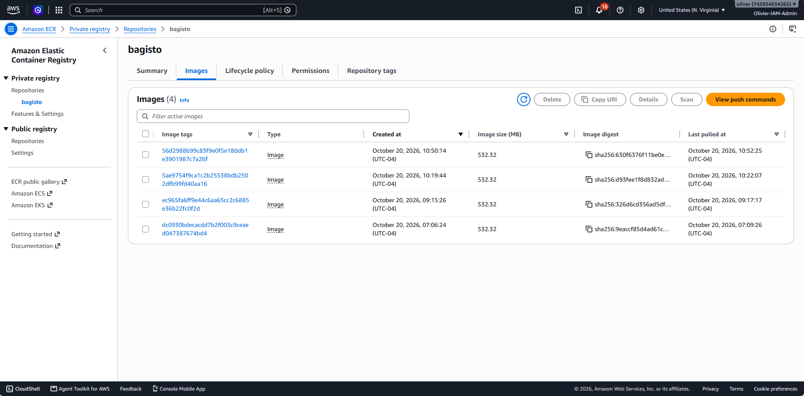
      <br><sub><b>Figure 11.</b> Private ECR <code>bagisto</code> · immutable tags are full git SHAs (no <code>latest</code>).</sub>
    </td>
  </tr>
</table>

---

## Configuration

`ansible/site.yaml` runs once on a new environment, after the first image is in ECR. It mounts EFS, renders `.env` from Secrets Manager, starts the shop, installs Bagisto once, switches search to Elasticsearch, joins Consul, and starts the scheduler service. Ansible connects through Session Manager: there is no SSH port and no key pair.

<table>
  <tr>
    <td align="center" valign="top" width="50%">
      <p align="center"><b>Ansible</b></p>
      
    </td>
    <td align="center" valign="top" width="50%">
      <p align="center"><b>Ansible over Session Manager</b></p>
      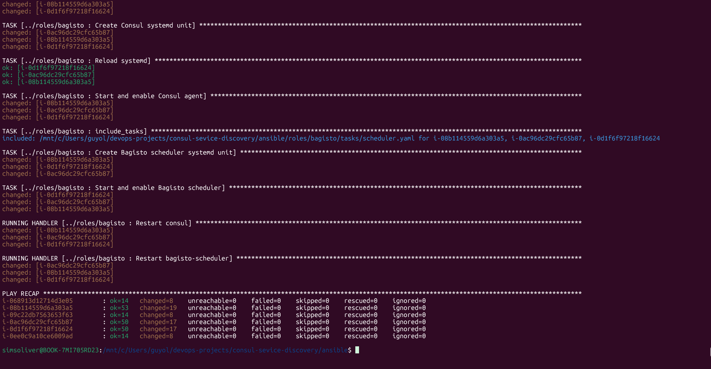
      <br><sub><b>Figure 12.</b> <code>site.yaml</code> recap · Consul agent and scheduler configured · <code>failed=0</code>, <code>unreachable=0</code>.</sub>
    </td>
  </tr>
</table>

---

## Hosts and self-healing

### Compute

Every host is private and belongs to an Auto Scaling group: three single-server Consul groups, one Nginx group, and one Bagisto group, plus the Elasticsearch instance.

<table>
  <tr>
    <td align="center" width="50%">
      <p align="center"><b>EC2 instances</b></p>
      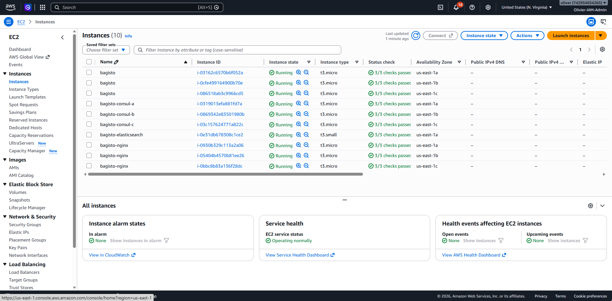
      <br><sub><b>Figure 13.</b> Ten private instances across us-east-1a, 1b, and 1c · no public IPs.</sub>
    </td>
    <td align="center" width="50%">
      <p align="center"><b>Auto Scaling groups</b></p>
      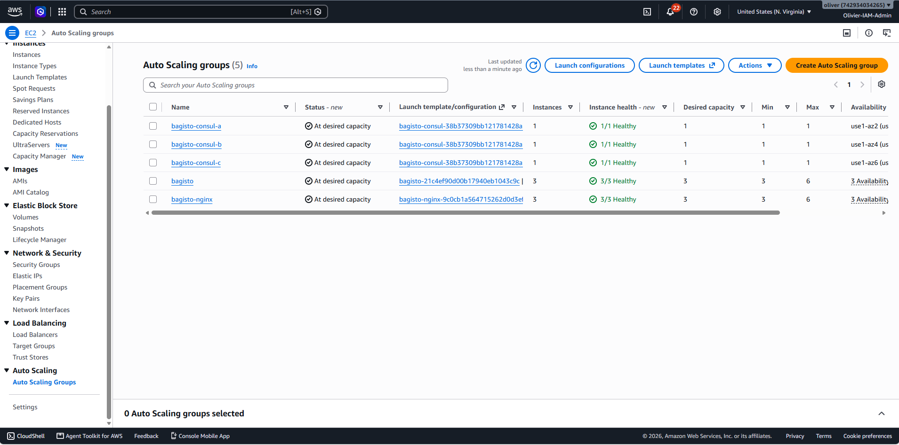
      <br><sub><b>Figure 14.</b> <code>bagisto-consul-a/b/c</code> (1 each) · <code>bagisto</code> (3) · <code>bagisto-nginx</code> (3) · all at desired capacity and healthy.</sub>
    </td>
  </tr>
</table>

### Network

The ALB is the only public entry point. Each tier has its own security group that accepts traffic only from the tier in front of it.

<table>
  <tr>
    <td align="center" width="50%">
      <p align="center"><b>Load balancer</b></p>
      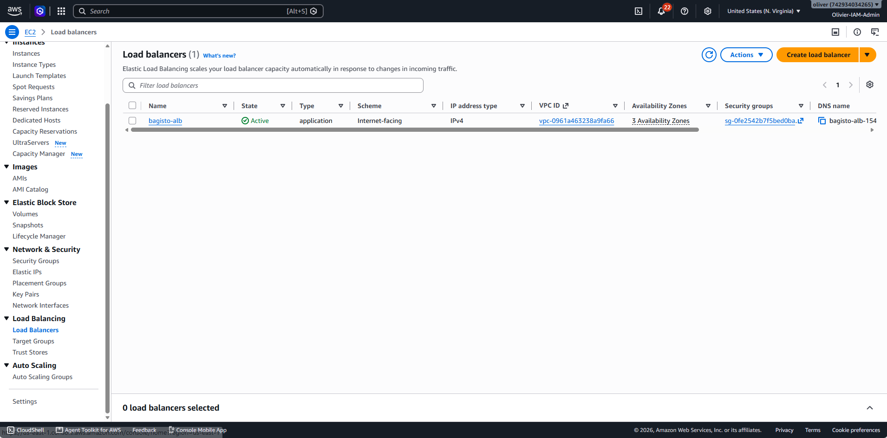
      <br><sub><b>Figure 15.</b> <code>bagisto-alb</code> · internet-facing · three AZs.</sub>
    </td>
    <td align="center" width="50%">
      <p align="center"><b>Security groups</b></p>
      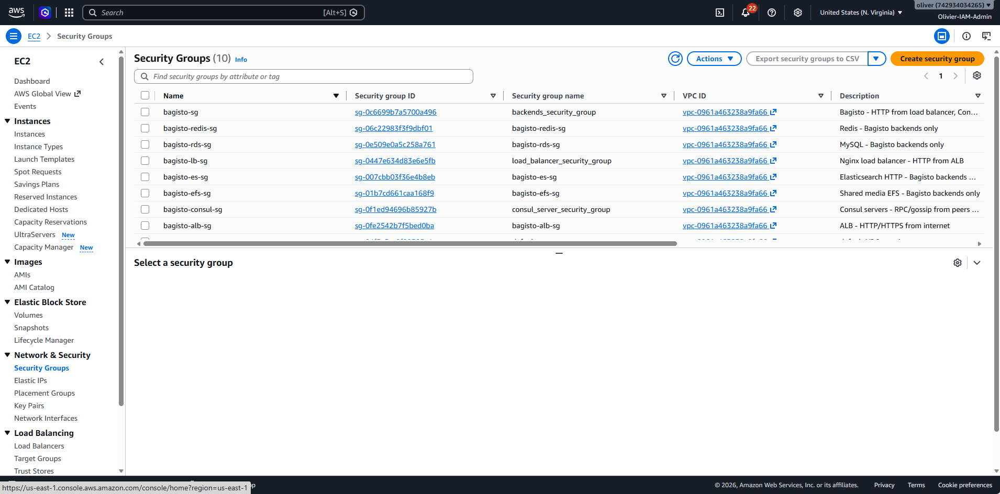
      <br><sub><b>Figure 16.</b> One security group per role · each opens only to the role that needs it.</sub>
    </td>
  </tr>
</table>

### Resilience tests

Each tier was tested by terminating **all** of its instances at once on the live environment, with no manual action during recovery:

| Tier lost | What happened | Site impact |
| --- | --- | --- |
| 3 Consul servers | Three ASGs replaced them in their own zones · the new servers formed a cluster, joined every agent, and the catalog and scheduler lock came back | None · Nginx kept serving its last upstream list |
| 3 Nginx proxies | Replacements joined Consul by tag and wrote the shop list with consul-template · ALB marked them healthy | About 1–2 minutes of intermittent 502s |
| 3 Bagisto shops | Replacements booted the SHA in `bagisto/image`, mounted EFS, joined Consul, and one took the scheduler lock | About 3 minutes 40 seconds of 503s |

No data was lost in any test: products, orders, accounts, and images live in RDS, Redis, Elasticsearch, and EFS.

---

## Data services

### Redis

Sessions, cache, and the job queue for every shop server.

<table>
  <tr>
    <td align="center">
      <p align="center"><b>ElastiCache Redis</b></p>
      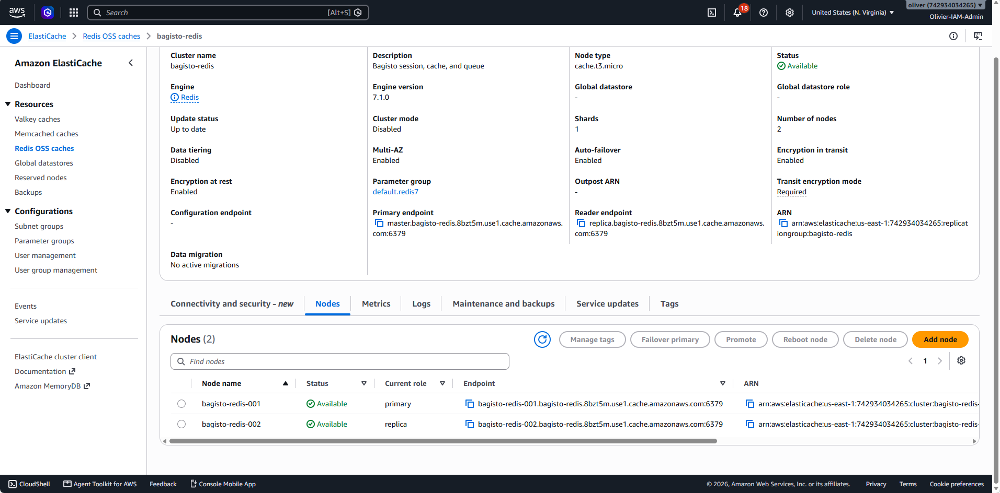
      <br><sub><b>Figure 17.</b> <code>bagisto-redis</code> · primary and replica · Multi-AZ failover · TLS required.</sub>
    </td>
  </tr>
</table>

### Elasticsearch

Product search, on a private EC2 instance over HTTPS.

<table>
  <tr>
    <td align="center" width="50%">
      <p align="center"><b>Cluster health</b></p>
      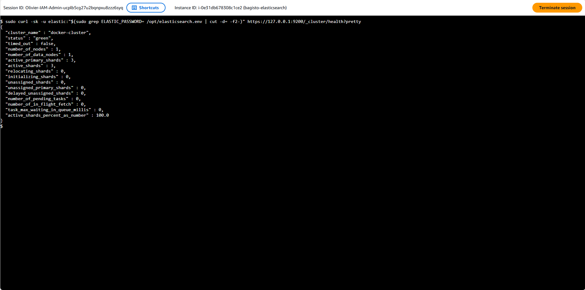
      <br><sub><b>Figure 18.</b> Cluster <code>green</code> over HTTPS · checked through Session Manager.</sub>
    </td>
    <td align="center" width="50%">
      <p align="center"><b>Search engine in Bagisto</b></p>
      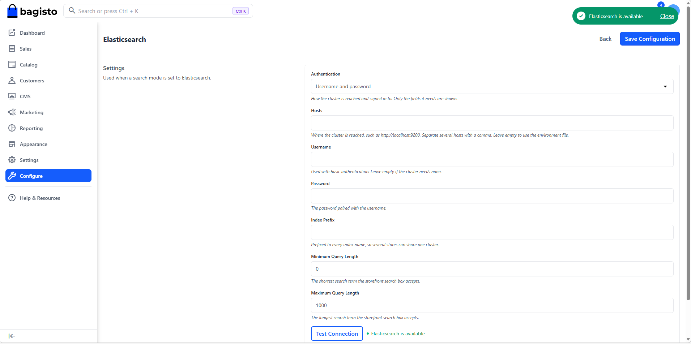
      <br><sub><b>Figure 19.</b> Connection test reports <i>Elasticsearch is available</i>.</sub>
    </td>
  </tr>
</table>

### MySQL

RDS MySQL 8.0 Multi-AZ with encrypted storage and TLS required. The shop verifies both MySQL and Elasticsearch with CA files written at boot.

---

## Email

Bagisto sends account and order email through Amazon SES from `no-reply@simsoliver.com`. The domain is verified with DKIM records that Terraform writes to Route 53. The shop's IAM role may send only from that address.

<table>
  <tr>
    <td align="center" width="50%">
      <p align="center"><b>SES identities</b></p>
      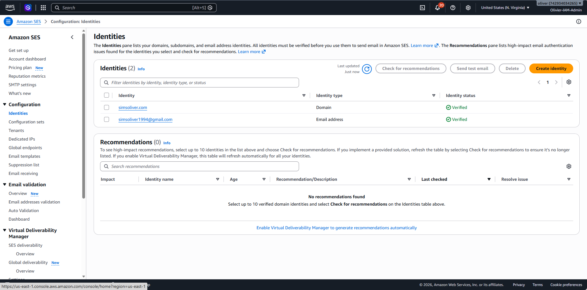
      <br><sub><b>Figure 20.</b> Domain identity verified · test recipient for the SES sandbox.</sub>
    </td>
    <td align="center" width="50%">
      <p align="center"><b>Delivered email</b></p>
      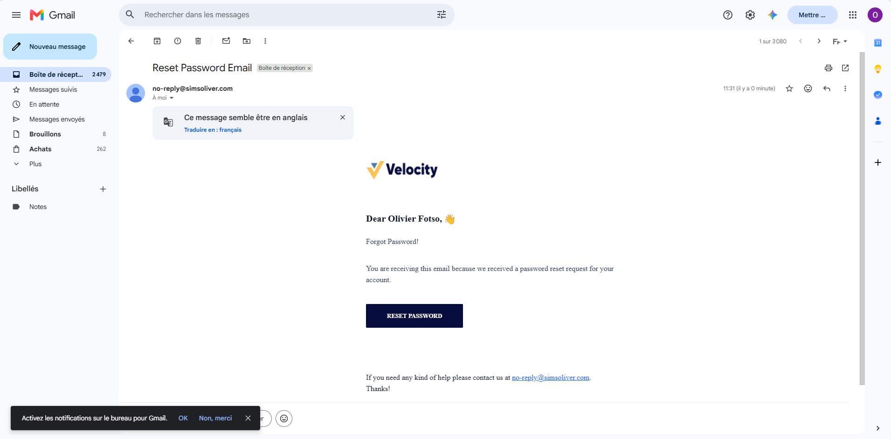
      <br><sub><b>Figure 21.</b> Password reset delivered through SES from <code>no-reply@simsoliver.com</code>.</sub>
    </td>
  </tr>
</table>

---

## Application (working run)

The storefront is served at `https://bagisto.simsoliver.com`, with TLS on the load balancer and HTTP inside the VPC. The environment is created and destroyed from code to avoid idle cost, so the hostname may not resolve when it is down. The screenshots below are the record of the working run.

### Storefront

<table>
  <tr>
    <td align="center" colspan="2">
      <p align="center"><b>Homepage</b></p>
      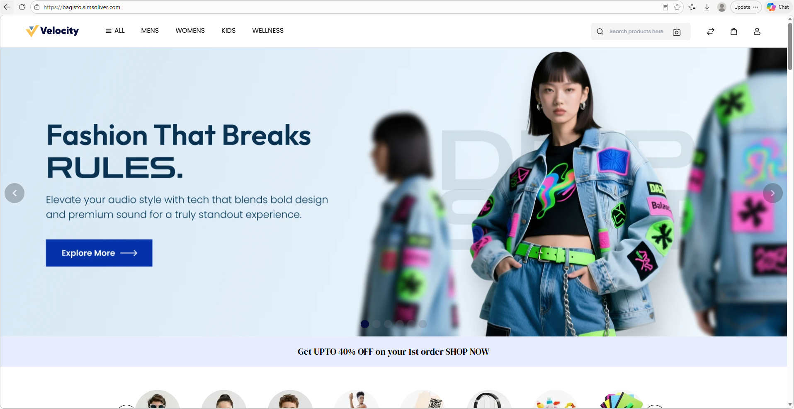
      <br><sub><b>Figure 22.</b> <code>https://bagisto.simsoliver.com</code> · banner images served from EFS.</sub>
    </td>
  </tr>
  <tr>
    <td align="center" width="50%">
      <p align="center"><b>Products</b></p>
      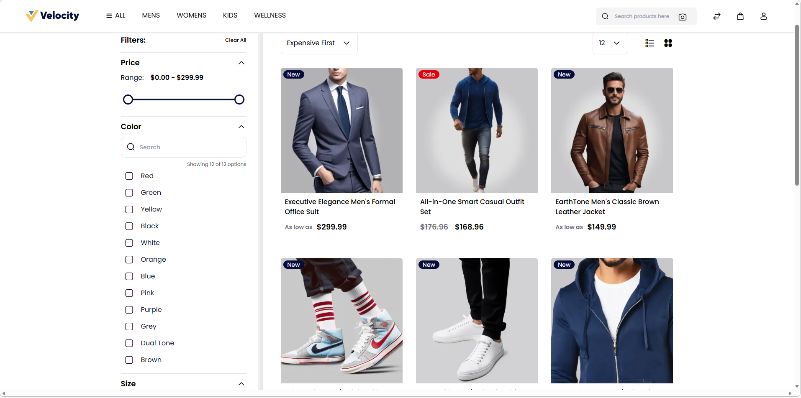
      <br><sub><b>Figure 23.</b> Catalog with filters and product images.</sub>
    </td>
    <td align="center" width="50%">
      <p align="center"><b>Customer login</b></p>
      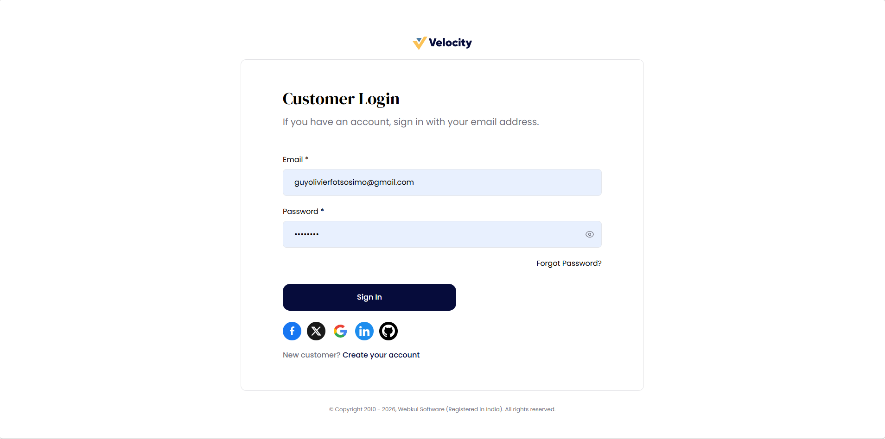
      <br><sub><b>Figure 24.</b> Customer login · session stored in Redis.</sub>
    </td>
  </tr>
</table>

### Checkout

<table>
  <tr>
    <td align="center" width="33%">
      <p align="center"><b>Billing address</b></p>
      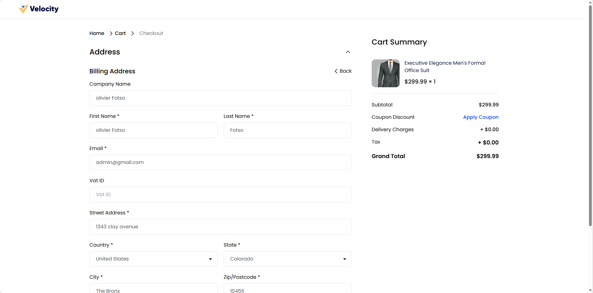
      <br><sub><b>Figure 25.</b> Billing address and cart summary.</sub>
    </td>
    <td align="center" width="33%">
      <p align="center"><b>Shipping method</b></p>
      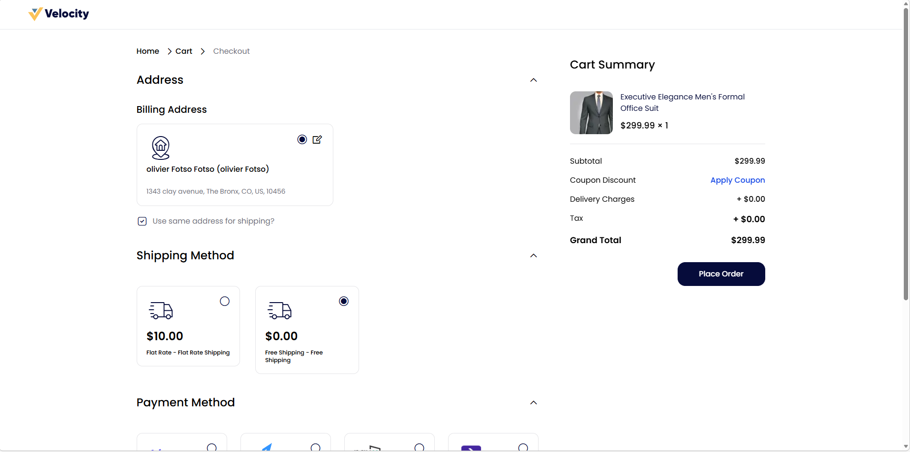
      <br><sub><b>Figure 26.</b> Shipping method · place order.</sub>
    </td>
    <td align="center" width="33%">
      <p align="center"><b>Order placed</b></p>
      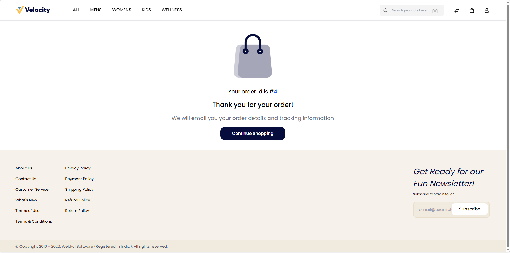
      <br><sub><b>Figure 27.</b> Order confirmation.</sub>
    </td>
  </tr>
</table>

### Admin panel

<table>
  <tr>
    <td align="center" width="33%">
      <p align="center"><b>Admin login</b></p>
      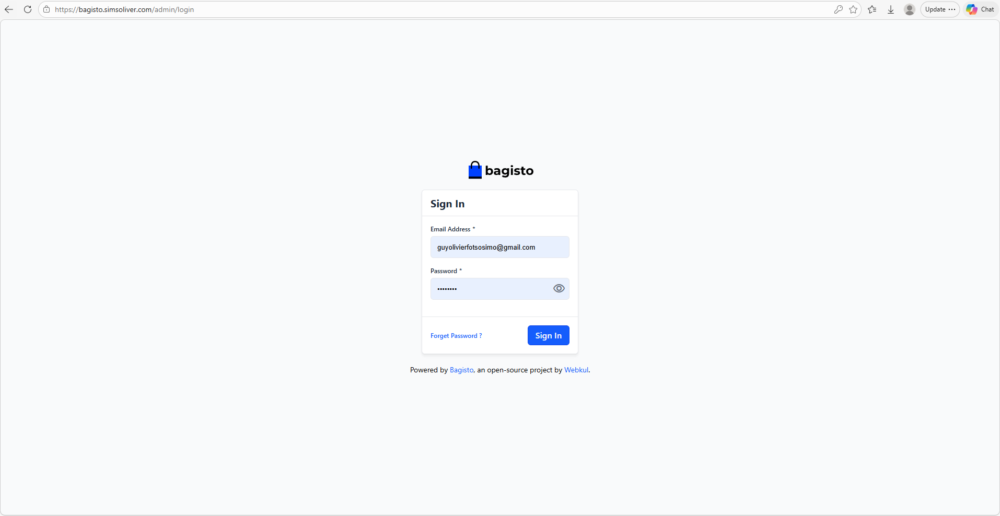
      <br><sub><b>Figure 28.</b> Sign-in at <code>/admin</code>.</sub>
    </td>
    <td align="center" width="33%">
      <p align="center"><b>Dashboard</b></p>
      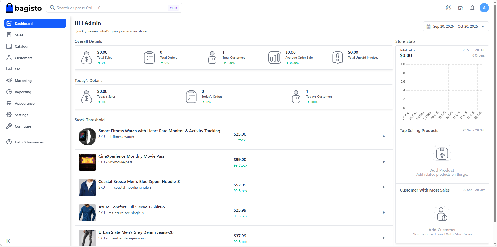
      <br><sub><b>Figure 29.</b> Store statistics and stock threshold.</sub>
    </td>
    <td align="center" width="33%">
      <p align="center"><b>Catalog</b></p>
      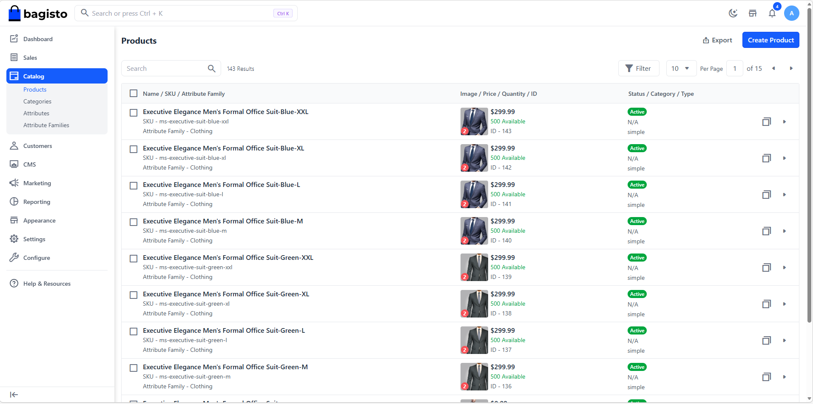
      <br><sub><b>Figure 30.</b> 143 products loaded by the one-time install.</sub>
    </td>
  </tr>
</table>

---

## Security snapshot

| Control | Implementation |
| --- | --- |
| Public exposure | Only the ALB is public · every instance is in a private subnet with no public IP |
| Access | Session Manager for shells and Ansible · no SSH port · no key pairs |
| Edge | ACM certificate · TLS 1.2/1.3 policy · HTTP 301 to HTTPS |
| Proxy and app | Nginx `:80` from the ALB only · Bagisto `:80` from Nginx only |
| Consul | RPC and gossip only between the Consul, Nginx, and Bagisto security groups · gossip encryption key |
| Data | MySQL, Redis, Elasticsearch, and EFS open only to the Bagisto security group · encrypted at rest · TLS in transit |
| Secrets | Secrets Manager JSON · read by instance roles · never in Git, tfvars, or the image |
| CI identity | GitHub OIDC role locked to this repository and `main` · no stored AWS keys |
| Images | Trivy before push · ECR scan on push · immutable SHA tags |
| Code | Gitleaks for secrets · Semgrep for risky patterns · Composer audit for vulnerable packages |
| State | S3 remote state · encrypted · versioned |

### Console access

<table>
  <tr>
    <td align="center">
      <p align="center"><b>Console access</b></p>
      
      <br><sub><b>Figure 31.</b> Day-to-day work as an IAM user, not the root account.</sub>
    </td>
  </tr>
</table>

---

## Challenges and solutions

Problems found while running and testing the platform, each traced to a root cause and fixed in code:

| Symptom | Root cause | Fix |
| --- | --- | --- |
| Shop showed no product images | The first install ran before EFS was mounted, so images landed on one server's disk and were later hidden by the mount | Deploy refuses to run without EFS · install marker moved to EFS · GitHub deploy skips a new environment |
| Install failed on `storage/app/private` | Mounting EFS created the parent folders as root | Ansible gives the storage folders to `www-data` before the install |
| Replacement shops returned 500 | The boot script encoded `APP_KEY` with a trailing newline (33 bytes) | `jq -j` instead of `jq -r` · key is exactly 32 bytes |
| Shops could not reach MySQL | An unquoted `#` in the generated password started a comment in `.env` | Database password generated from letters and digits only |
| Agents lost Consul after all servers were replaced | Agents run auto-join only at start, so new servers formed a separate cluster | Booting Consul servers also join the Nginx and Bagisto agents by tag |

---

## Next steps

Improvements identified during testing, in priority order:

| Improvement | Why |
| --- | --- |
| Rolling deploy (`serial: 1`) | Today all shops switch containers at the same time, which causes a few seconds of 503s |
| Database migrations in the deploy | A release that adds tables or columns needs `php artisan migrate --force` on one shop |
| SES production access | The account is still in the SES sandbox, so mail reaches verified addresses only |
| Consul ACLs and TLS | Gossip is encrypted, but the HTTP API has no ACL tokens and RPC has no TLS yet |
| Consul snapshots to S3 | Not needed while Consul holds only rebuildable data · required once KV or ACL data is stored |

---

## Cost

Approximate monthly cost of the full environment running 24/7, on-demand pricing in `us-east-1`. These are estimates, not billing data, and they exclude data transfer.

| Resource | Quantity | Approx. per month |
| --- | --- | --- |
| NAT Gateways | 3 (one per AZ) | $100 |
| EC2 `t3.micro` (Consul, Nginx, Bagisto) | 9 | $70 |
| RDS MySQL `db.t3.micro` Multi-AZ | 1 primary + standby | $55 |
| ElastiCache Redis `cache.t3.micro` | 2 nodes | $25 |
| Public IPv4 addresses (NAT and ALB) | 6 | $22 |
| Application Load Balancer | 1 | $20 |
| EC2 `t3.small` (Elasticsearch) | 1 | $15 |
| EBS, EFS, ECR, Secrets Manager, Route 53, SES | — | $15 |
| **Total** | | **$320 per month · $0.45 per hour** |

The NAT Gateways are the largest line, the price of keeping one egress path per Availability Zone. Because the whole environment is built from code, it is torn down when not in use and recreated in about an hour: a three-hour working session costs about $1.35. A single NAT Gateway and smaller groups would cut the cost by roughly a quarter, at the price of zone-level redundancy.

---

## Operations

### Lifecycle

```
terraform/bootstrap  →  terraform/live
      →  GitHub Actions: first image to ECR (deploy skips a new environment)
      →  ansible site.yaml with that SHA (EFS, install once, record bagisto/image)
      →  every later merge to main deploys through GitHub
```

### Runbooks

The private repository includes these runbooks:

| Document | Use |
| --- | --- |
| `RECREATE-GUIDE` | Ordered bring-up of a new environment |
| `DESTROY-GUIDE` | Ordered teardown |
| `PROJECT-FLOW` | End-to-end walkthrough: Terraform, Ansible, machines, traffic |
| `CI-CHECKS` | What each pipeline gate checks |
| `IMAGE-DEPLOY` | How a change reaches the shops, from pull request to deploy |
| `SG-TRAFFIC` | Security group rules by role |
| `VPC-RESOURCES` | Subnets, routes, and what runs where |
| `REDIS-AND-TRAFFIC` | Redis usage and request flow |
| `WORKER-AND-SCHEDULER` | Queue worker and the single scheduler |

Session Manager is the only way into the hosts. The Consul UI is on `:8500` of a Consul server, reached through a Session Manager port forward.

---

Olivier Fotso
